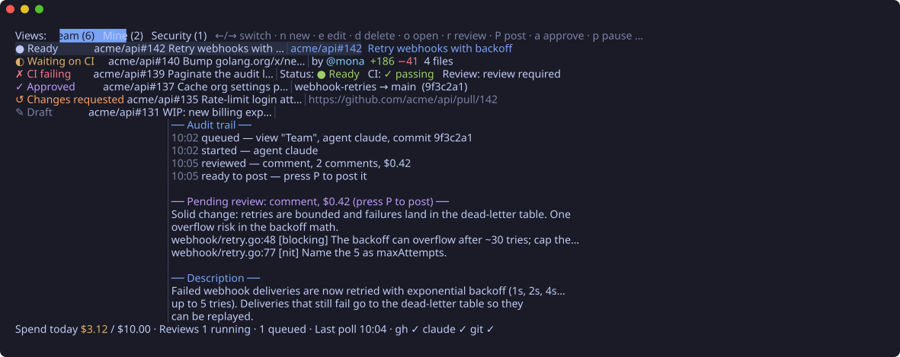
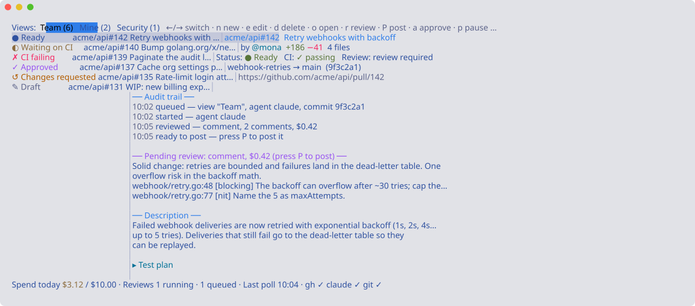
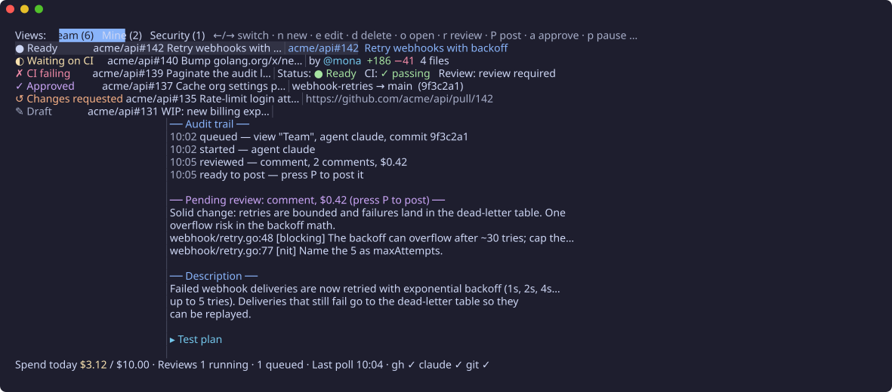

# Ghost

[](https://github.com/AdamIsrael/ghost/actions/workflows/ci.yml)

Ghost is a terminal UI that watches GitHub pull requests and reviews them with an AI agent. It polls the PR searches you define, shows each PR's status, runs reviews with [Claude Code](https://docs.claude.com/en/docs/claude-code), and posts the review comments (and, if you allow it, approvals) back to GitHub, all within a daily budget you set.



## Requirements

- **Go 1.27.1** or newer, to build Ghost.
- **[GitHub CLI](https://cli.github.com) (`gh`)**, logged in (`gh auth login`). Ghost uses your `gh` login for GitHub, so it can see the same repos you can.
- **[Claude Code](https://docs.claude.com/en/docs/claude-code) (`claude`)**, logged in. Reviews run through it and are billed to your Claude account.
- **git**.
- macOS or Linux.

## Install

Download a binary for Linux or macOS (Intel or Apple silicon) from the [releases page](https://github.com/AdamIsrael/ghost/releases), unpack it, and put `ghost` on your `PATH`. `checksums.txt` lists each archive's SHA-256.

Or build it with Go:

```bash
go install github.com/AdamIsrael/ghost/cmd/ghost@latest
```

`ghost --version` shows which version you have.

## Quick start

1. Create the starter config:
   ```bash
   ghost init
   ```
   This writes `~/.config/ghost/config.toml`, `views.toml` and `prompts/default.md`. It never overwrites existing files.
2. Check your setup:
   ```bash
   ghost --check
   ```
   It confirms `git`, `gh` (including login) and `claude` are available and that your config is valid.
3. Start the TUI:
   ```bash
   ghost
   ```
   The starter view lists PRs where your review is requested. Nothing is reviewed automatically until you turn on `auto_review` for a view, so nothing is spent yet.
4. Review one PR:
   ```bash
   ghost review https://github.com/owner/repo/pull/123
   ```
   Ghost opens on a tab for that PR and starts reviewing it. When the review is ready, look it over in the detail pane and press `P` to post it, or don't. Add `--dry-run` to print the review in the terminal instead, without opening Ghost or posting.

## How it works

1. **Views** are GitHub searches, such as `is:open is:pr review-requested:@me`. Ghost runs each one every `poll_interval`. A search that hits a GitHub server error or a network blip is retried within seconds; a view that still fails is re-polled on its own after 30s (then 1m, 2m, …) instead of waiting for the next round.
2. For views with `auto_review = true`, each new PR commit is queued for **one** review. Drafts are skipped, and a review that fails is not retried automatically (press `r` to retry).
   If `review_label` is set, Ghost first adds that label to the PR and reviews it on the next poll; see [Review label](#review-label).
3. A review runs Claude Code against a temporary checkout of the PR, using your agent's prompt. Ghost then checks the result for anything that looks like a secret.
4. With `post_mode = "confirm"` (the default), the finished review waits in the detail pane until you press **`P`** to post it. With `"auto"`, it posts right away.
5. If `[auto_approve]` is enabled and the PR meets its rules, Ghost offers an approval (press **`a`**), or approves on its own when `require_confirm = false`.

Every step is recorded in the PR's audit trail, shown in the detail pane.

## Safety and cost

- **The agent can only read.** Reviews run with no shell and no write tools, are confined to the PR checkout, and ignore the repo's own Claude settings, hooks, plugins and `CLAUDE.md`. Ghost computes the diff itself and hands it to the agent.
- **Ghost posts, the agent doesn't.** Every review is scanned for secret-like strings (GitHub, AWS, Anthropic, Slack and Google keys, private keys) before posting. A match blocks the review permanently.
- **Spend is capped.** A review starts only if `max_daily_cost_usd` leaves room for it at `max_cost_per_review_usd`. A review that is cut short (you quit, or it crashes) is counted at the per-review cap.
- **Nothing posts twice.** Each posted review and approval carries a hidden marker. If GitHub's response is lost, Ghost checks for the marker before trying again.
- **Approvals are careful.** Ghost approves only the PR's latest review, only the exact commit it reviewed, and only after rechecking the rules against GitHub right before approving. It never approves a commit twice. GitHub doesn't let you approve your own PRs, so Ghost can't either.
- Only one Ghost can run against a given database at a time.

## Keys

| Key | Action |
|---|---|
| `←` `→` / `h` `l` / `tab` | Switch view |
| `↑` `↓` / `j` `k` | Move through PRs |
| `o` / `enter` | Open the PR in your browser |
| `r` | Review the selected PR now, even if its CI is red or pending. Ghost confirms it's queued, and if it can't start yet (paused, daily budget reached, or `max_concurrent_reviews` busy) it says why |
| `P` | Post the selected PR's pending review |
| `a` | Approve the selected PR (when an approval is pending) |
| `p` | Pause or resume starting new reviews |
| `R` | Poll GitHub now |
| `n` / `e` / `d` | New, edit or delete a view (`d` asks for `y` to confirm) |
| `t` | Cycle color themes |
| `q` / `ctrl+c` | Quit |

In the view form: `tab` moves between fields, `space` toggles auto-review, `←` `→` pick the agent, type `-` in Label for no label, leave Max PRs blank for the default, `enter` saves and `esc` cancels.

## Configuration

Ghost reads `~/.config/ghost/config.toml` (or `$XDG_CONFIG_HOME/ghost/config.toml`). Ghost never writes this file, so your comments stay put. Unknown keys are an error, so typos don't go unnoticed.

| Key | Default | Meaning |
|---|---|---|
| `poll_interval` | `"5m"` | How often each view is polled (minimum `30s`) |
| `max_concurrent_reviews` | `2` | Reviews running at once |
| `max_daily_cost_usd` | `10.0` | Spend cap per local day |
| `max_cost_per_review_usd` | `1.5` | Cap for a single review (passed to Claude Code) |
| `post_mode` | `"confirm"` | `"confirm"` (press `P`) or `"auto"` |
| `theme` | `"auto"` | Color theme; see [Themes](#themes) |
| `default_agent` | `"claude"` | Agent used when a view doesn't name one |
| `review_footer` | `""` (off) | Text added below each posted review |
| `approval_message` | `""` (off) | Text of each approval |
| `review_label` | `""` (off) | Label Ghost adds before reviewing; removing it opts a PR out |
| `max_prs_per_view` | `50` | How many PRs each view shows (1–100) |
| `log_file` | `~/.local/state/ghost/ghost.log` | Where Ghost logs; `""` turns logging off. See [Logs](#logs) |

### Footer and approval message

Posts carry only the review by default; nothing says it came from Ghost. To add a note, set either option to a Go template using `{{.Agent}}`, `{{.Model}}`, `{{.Repo}}`, `{{.Number}}` and `{{.HeadSHA}}` (7 characters):

```toml
review_footer = "<sub>Automated review · agent `{{.Agent}}` · commit {{.HeadSHA}}</sub>"
approval_message = "Approved by Ghost: no blocking issues found."
```

Each post also ends with a hidden HTML comment that Ghost uses to avoid posting twice; it isn't shown on GitHub.

### Review label

```toml
review_label = "ai-review"
```

With a label set, Ghost doesn't review a PR the first time it sees it. It adds the label (creating it in the repo if needed) and reviews on the next poll, which gives the author a heads-up. Removing the label opts the PR out: Ghost won't add it again or review that PR, even after new commits, until someone adds the label back. A PR that already has the label is reviewed right away.

- A view can use a different label (`label = "needs-ai"`) or none (`label = ""`); in the TUI's view form, leave **Label** blank for the default or type `-` for none.
- Adding labels needs triage or write access to the repo. If it fails, the PR isn't reviewed and the audit trail says why; Ghost retries every poll.
- Pressing `r` reviews a PR regardless of the label.

### Agents and prompts

Each `[agents.<name>]` table defines a reviewer with its own model and prompt:

```toml
[agents.security]
kind = "claude"
model = "claude-opus-5-5"
prompt = """
Review {{.Repo}}#{{.Number}} ("{{.Title}}") for security problems only.
"""
```

Use `prompt` inline or `prompt_file` (a path relative to the config file, or under `~/`). Prompts are Go templates with these variables: `{{.Repo}}`, `{{.Number}}`, `{{.Title}}`, `{{.Author}}`, `{{.Body}}`, `{{.BaseRef}}`, `{{.HeadRef}}`, `{{.HeadSHA}}`, `{{.URL}}` and `{{.ChangedFiles}}` (`{{join .ChangedFiles ", "}}` joins the file names). Ghost appends a fixed section telling the agent where the diff is and how to format its answer, so a custom prompt can't break parsing.

To see exactly what an agent will be sent, for free:

```bash
ghost review owner/repo#123 --agent security --show-prompt
```

### Views

Views live in `views.toml` next to `config.toml`. You can edit them in the TUI (`n`, `e`, `d`) or by hand while Ghost is stopped; saving from the TUI rewrites the file, so its comments aren't kept.

```toml
[[view]]
name = "Team"
query = "is:open is:pr review-requested:@me"
auto_review = true        # reviews start, and cost money, as soon as this is saved
agent = "security"        # optional; defaults to default_agent
label = "needs-ai"        # optional; overrides review_label, "" = none
max_prs = 100             # optional; overrides max_prs_per_view (1–100)
```

`[[view]]` tables in `config.toml` also work, but they're read-only in the TUI. View names must be unique across both files.

#### View recipes

A view's query is a [GitHub search](https://docs.github.com/en/search-github/searching-on-github/searching-issues-and-pull-requests). Start with `is:open is:pr` and add qualifiers; in the TUI, press `n` and paste the query. Replace `myorg`, `alice` and the other placeholders with your own.

| View | Query |
|---|---|
| Waiting on my review | `is:open is:pr review-requested:@me` |
| My open PRs | `is:open is:pr author:@me` |
| Anything I'm involved in | `is:open is:pr involves:@me` |
| A team's PRs | `is:open is:pr org:myorg author:alice author:bob author:carol` |
| One repo | `is:open is:pr repo:myorg/api` |
| Several repos | `is:open is:pr repo:myorg/api repo:myorg/web` |
| A whole org, except one repo | `is:open is:pr org:myorg -repo:myorg/sandbox` |
| Ready PRs only (no drafts) | `is:open is:pr org:myorg draft:false` |
| No dependency bots | `is:open is:pr org:myorg -author:app/dependabot -author:app/renovate` |
| Not reviewed by anyone yet | `is:open is:pr org:myorg review:none` |
| Approved, ready to merge | `is:open is:pr org:myorg review:approved status:success` |
| CI failing | `is:open is:pr org:myorg status:failure` |
| Into one branch | `is:open is:pr repo:myorg/api base:main` |
| Has a label | `is:open is:pr org:myorg label:needs-review` |
| Has either label | `is:open is:pr org:myorg label:bug,security` |
| Has no labels | `is:open is:pr org:myorg no:label` |
| Oldest first | `is:open is:pr org:myorg sort:created-asc` |

How qualifiers combine:

- **Repeating `author:`, `repo:` or `org:` means any of them.** `author:alice author:bob` matches PRs by either person.
- **Repeating `label:` means all of them; a comma means any.** `label:bug label:security` needs both labels, `label:bug,security` needs either.
- **A leading `-` excludes**: `-author:`, `-repo:`, `-label:`.
- **`OR` and parentheses don't work here.** `(author:alice OR author:bob)` works on github.com but matches nothing through the API Ghost uses; repeat the qualifier instead.
- **Relative dates don't work** (`updated:>@today-7d` matches nothing), and a fixed date goes stale, so filter by state rather than time.
- **Each view shows 50 PRs by default**, newest first. A tab reads `Team (50+)` when GitHub has more matches. Raise it with `max_prs` on the view or `max_prs_per_view` in `config.toml` (up to 100, GitHub's limit for one request), narrow the query (a repo, `draft:false`, `review:none`), or use `sort:` to choose which PRs come first.
- **Scope wide queries** with `org:` or `repo:`; without one, a query searches every repository you can see.
- **An empty org view may mean access, not an empty org.** If an organization enforces SAML single sign-on and your `gh` login isn't authorized for it, GitHub returns nothing; Ghost shows GitHub's reason in the view. Authorize your `gh` token for the organization's SSO: run `gh auth refresh` and grant access, or use GitHub Settings → Applications → Authorized OAuth Apps → GitHub CLI.

Most of these views are for watching. Before setting `auto_review = true` on one, consider how many PRs it matches: every new commit on every match is reviewed and counts against `max_daily_cost_usd`. A [review label](#review-label) gives authors a way to opt out.

### Auto-approve

```toml
[auto_approve]
enabled = true
require_confirm = true      # false = approve without asking
require_ci_green = true
no_checks_is_green = false  # PRs with no CI checks aren't "green" unless true
no_blocking_comments = true
no_changes_requested = true
max_changed_lines = 400     # 0 = no limit
```

A PR qualifies only if the agent's verdict is "approve" and every enabled rule passes. If only CI, draft status or a human's requested changes are in the way, the approval waits and is rechecked on every poll.

## Themes

Set `theme` in `config.toml`, or press `t` to try them live. The status bar tells you which line to add to keep one.

Built-ins: `dark`, `light`, `high-contrast`, `mono`, `tokyo-night`, `tokyo-night-storm`, `tokyo-night-day`, `catppuccin-mocha`, `catppuccin-latte`, `dracula`, `nord`, `gruvbox-dark`, `solarized-dark` and `solarized-light`.

<p>


</p>

- `auto` picks `dark` or `light` from your terminal's background. Until the terminal answers, it uses neutral colors that read on either.
- `NO_COLOR=1` turns colors off.
- Every built-in meets a contrast check: text and hints at 4.5:1, status colors at 3:1.

To add your own, create `~/.config/ghost/themes/<name>.toml`. Copying a built-in from [`internal/theme/builtin/`](internal/theme/builtin) is the easiest start. Colors are `"#rrggbb"` or an ANSI index `"0"`–`"255"`, and any role you leave out uses your terminal's color.

```toml
name = "My theme"
background = "#1a1b26"   # optional: Ghost paints the whole screen
foreground = "#c0caf5"
muted = "#7b81a7"        # hints, URLs, timestamps, drafts
border = "#3b4261"
accent = "#7aa2f7"       # active view tab
on_accent = "#1a1b26"
heading = "#7aa2f7"
selection = "#292e42"    # selected row
success = "#9ece6a"      # Ready, CI passing, additions
warning = "#e0af68"      # Waiting on CI, spend
error = "#f7768e"        # CI failing, deletions, errors
attention = "#ff9e64"    # Changes requested
special = "#bb9af7"      # Approved, pending review
info = "#7dcfff"         # authors
```

A file named after a built-in replaces it. `ghost --check` warns if your selected theme is hard to read.

## Logs

The TUI has to cut long messages to fit. Ghost also writes every error in full, plus what it did (queued, posted, approved, labeled…), to `~/.local/state/ghost/ghost.log` (or `$XDG_STATE_HOME/ghost/ghost.log`):

```
time=2026-10-26T11:41:02.318-04:00 level=ERROR msg="poll failed" view=Team query="is:open is:pr org:acme" err="search: HTTP 502: 502 Bad Gateway (https://api.github.com/graphql)"
time=2026-10-26T11:43:10.904-04:00 level=INFO msg=posted pr=acme/api#42 review=17 detail="REQUEST_CHANGES with 3 inline comments"
```

- Follow it while Ghost runs: `tail -f ~/.local/state/ghost/ghost.log`. Find problems: `grep -E 'level=(ERROR|WARN)' ~/.local/state/ghost/ghost.log`.
- A view that keeps failing logs its error once, again only if the message changes, and `poll recovered` when it works again.
- The file is capped at 5 MB; the previous one is kept as `ghost.log.1`.
- Set `log_file` in `config.toml` to write it elsewhere, or `log_file = ""` to turn it off. `ghost --check` shows where it goes.
- Control characters in messages are escaped, so tailing the log can't be used to mess with your terminal.

## Command line

```
ghost [--config PATH] [--db PATH]                  start the TUI
ghost [--config PATH] init                         write starter config, views and prompt
ghost [--config PATH] --check                      check tools, login and config
ghost --version                                    print the version
ghost [--config PATH] [--db PATH] review <pr>      open Ghost on that PR and review it (post with P)
ghost [--config PATH] review <pr> --dry-run        review one PR and print it; posts nothing
ghost [--config PATH] review <pr> --show-prompt    print the prompt; runs nothing
```

`<pr>` is a PR URL or `owner/repo#123`. Add `--agent NAME` to `review` to use a specific agent.

`ghost review <pr>` adds a tab for that PR for this session only (it isn't saved to `views.toml`) and starts a review even if the PR's current commit was reviewed before, as pressing `r` does. Posting follows `post_mode` as usual. Only one Ghost can use the database at a time, so if Ghost is already open, switch to it and press `r` on the PR there.

## Files

| Path | Contents |
|---|---|
| `~/.config/ghost/config.toml` | Settings (yours; Ghost never writes it) |
| `~/.config/ghost/views.toml` | Views managed from the TUI |
| `~/.config/ghost/prompts/` | Prompt files |
| `~/.config/ghost/themes/` | Your themes |
| `~/.local/share/ghost/ghost.db` | Reviews, audit trail and spend (SQLite) |
| `~/.cache/ghost/` | Blobless clones of reviewed repos, and per-review checkouts (removed after each review) |
| `~/.local/state/ghost/ghost.log` | Log of errors and actions (and `ghost.log.1`, the previous 5 MB) |

These follow `XDG_CONFIG_HOME`, `XDG_DATA_HOME`, `XDG_STATE_HOME` and `XDG_CACHE_HOME` when set.

## Development

```bash
go test -race ./...
go vet ./...
go run honnef.co/go/tools/cmd/staticcheck@v0.8.2 ./...
```

CI runs these (plus a `gofmt` check) on Linux and macOS for every push and pull request. Pushing a tag like `v0.1.0` builds release binaries with [GoReleaser](https://goreleaser.com) and publishes them on the releases page; `goreleaser release --snapshot --clean` does a local dry run into `dist/`.

`scripts/screenshot.sh` regenerates the screenshots in [`docs/screenshots/`](docs/screenshots) from the real TUI with made-up data; it needs [freeze](https://github.com/charmbracelet/freeze) (`go install github.com/charmbracelet/freeze@v0.2.2`).

The design docs and implementation plans are in [`docs/superpowers/`](docs/superpowers). Work is tracked with [beads](https://github.com/gastownhall/beads) (`bd ready`).

## License

Apache License 2.0; see [LICENSE](LICENSE).
